# DP–zkML

**A runnable reference implementation of verifiable, differentially-private machine-learning inference.**

This repository turns the architecture specified in *Zero-Knowledge Machine Learning
with Differential Privacy* (Mitra, Adithyan K.R, Sagnik Mitra, Karthikeyan PR — VIT Chennai)
from an analytical design study into executable code: a conservative privacy accountant, an
exact-support discrete-Gaussian sampler, an append-only release ledger, a quantized aggregate
reference query, and the analytical evaluation that reproduces the paper's own figures.

> **Paper status.** The source paper is a *design study*: no neural network is trained and no
> proof backend is benchmarked. Its results are analytical formulas and synthetic plots. This
> repo reproduces those formulas exactly, then builds toward the real ZK relation (Track D).

---

## Table of contents

- [Why this exists](#why-this-exists)
- [Reference architecture](#reference-architecture)
- [The verification relation (Algorithm 1)](#the-verification-relation-algorithm-1)
- [Release lifecycle](#release-lifecycle)
- [Data pipeline](#data-pipeline)
- [Threat model](#threat-model)
- [Repository layout](#repository-layout)
- [Module map](#module-map)
- [Quick start](#quick-start)
- [Usage](#usage)
- [Acceptance numbers](#acceptance-numbers)
- [API reference](#api-reference)
- [Analytical figures](#analytical-figures)
- [Testing](#testing)
- [Roadmap](#roadmap)
- [Design rules](#design-rules)
- [Citation](#citation)

---

## Why this exists

Outsourced machine learning splits one problem into three **different** guarantees:

| Requirement | Question it answers | Mechanism |
|---|---|---|
| **Execution integrity** | Did the advertised model actually run? | Zero-knowledge proofs (zkML) |
| **Input confidentiality** | Was the input kept from the verifier? | Witness zero-knowledge |
| **Output privacy** | Do outputs leak training records? | Differential privacy (DP) |

A correct proof does **not** prove the noise seed was honest, and a public seed lets an observer
subtract the noise. This repo implements the interface that binds all three: quantized inference,
finite noise sampling, conservative accounting, and an atomic release ledger — with the paper's
assumptions made explicit (`A1`–`A4`).

---

## Reference architecture

The paper separates four logical roles plus a verifier. None of these need be separate machines.

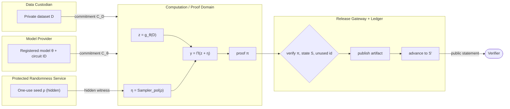

**Roles:** the *custodian* supplies records; the *provider* supplies the registered model; the
*randomness service* delivers a one-use private seed bound to the request; the *gateway* controls
which outputs and state transitions are published; the *verifier* checks the execution claim.

---

## The verification relation (Algorithm 1)

The proof binds a **deterministic execution relation** — not a distributional test on one sample:

$$
\mathcal{R}_{dpzk}:\quad z = g_\theta(D),\ \ \eta = \mathrm{Sampler}_{pol}(\rho),\ \ y = \Pi(z+\eta),\ \ S' = \mathrm{Update}(S, pol, id)
$$

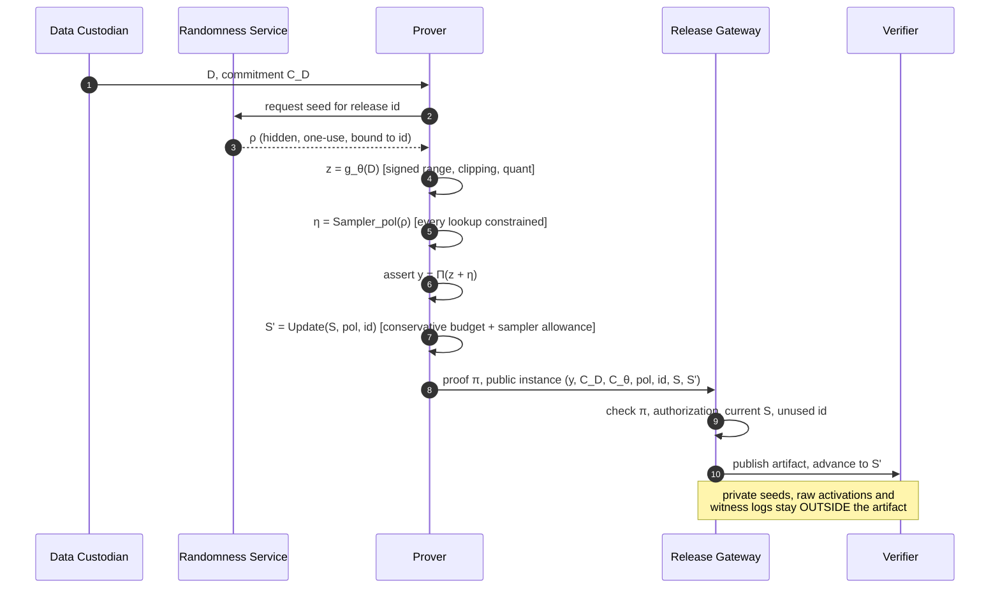

**What the relation checks, step by step:**

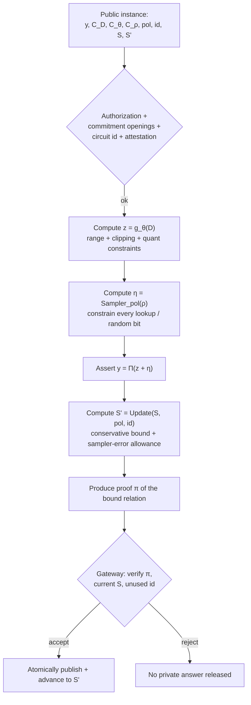

---

## Release lifecycle

The ledger enforces a **single-successor policy**: exactly one authorized transition may consume a
predecessor state. This prevents budget rollback and proof replay across unrelated histories.

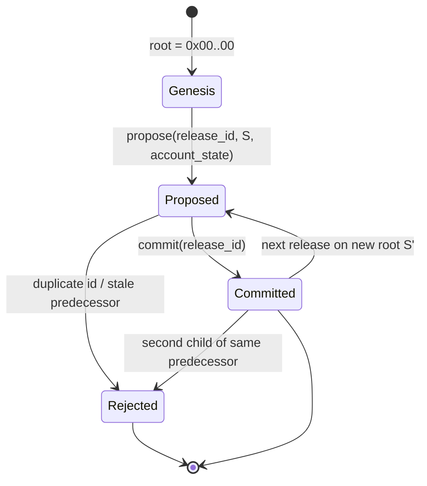

Failure behavior is part of the privacy analysis (paper Table VII). Crash-after-publication must
**retain** conservative expenditure — a client claiming it never received the response cannot
refund privacy budget.

---

## Data pipeline

The paper's narrow, fully-specified starting workload is a clipped, quantized integer aggregate.

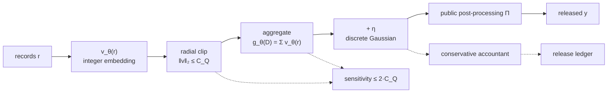

- **Sensitivity.** Replacement sensitivity of the aggregate is at most $2C_Q$ (cancellation of
  unchanged summands + triangle inequality).
- **Field bound.** A sufficient field size for a fan-in $k$ dot product is $p > 2(kAW + B)$.
- **Post-processing.** Division by a public dataset size happens *after* noise addition.

---

## Threat model

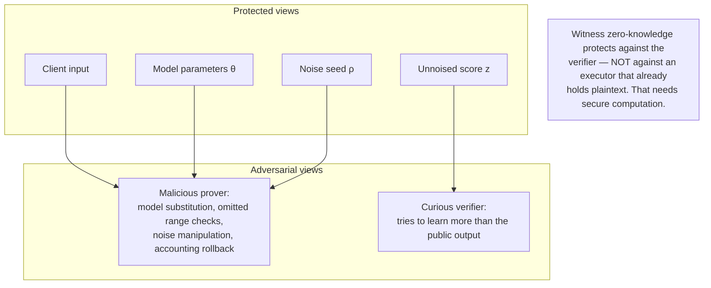

**Assumptions made explicit (A1–A4):**

| ID | Assumption |
|---|---|
| **A1** | Authorized semantics: circuit, model registration, adjacency, sensitivity certificate, release mapping approved independently of the protected dataset. |
| **A2** | Protected randomness: each request gets a one-use private seed with the required conditional distribution, hidden from the adversary. |
| **A3** | Controlled release: all observable outcomes follow the modeled protocol; aborts/retries/timing are independent of protected data. |
| **A4** | Cryptographic realization: commitments hiding & binding; the proof system has completeness, knowledge soundness, zero-knowledge. |

---

## Repository layout

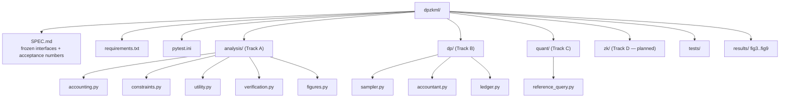

```
dpzkml/
├── SPEC.md                     # frozen interfaces, track ownership, acceptance numbers
├── README.md
├── requirements.txt
├── pytest.ini
├── analysis/                   # Track A — analytical reproduction
│   ├── accounting.py           #   Eqs. 4–5  (RDP / zCDP)
│   ├── constraints.py          #   Eqs. 12–13 (constraint + proving-work proxies)
│   ├── utility.py              #   Eq. 14     (synthetic utility + calibration)
│   ├── verification.py         #   Eq. 15     (log-normal verification-work model)
│   └── figures.py              #   regenerates figs 3–9 into results/
├── dp/                         # Track B — DP core
│   ├── sampler.py              #   exact-support discrete Gaussian + pmf
│   ├── accountant.py           #   interval-valued RDP/zCDP accountant
│   └── ledger.py               #   append-only single-successor release ledger
├── quant/                      # Track C — quantized reference query
│   └── reference_query.py      #   int8 aggregate, clipping, sensitivity, field bound
├── zk/                         # Track D — ZK relation + verifier (planned)
├── tests/                      # pytest suites
│   ├── test_a_accounting.py
│   ├── test_a_constraints.py
│   ├── test_a_utility.py
│   ├── test_a_verification.py
│   └── test_b_dp.py
└── results/                    # generated figures (fig3..fig9 .png)
```

---

## Module map

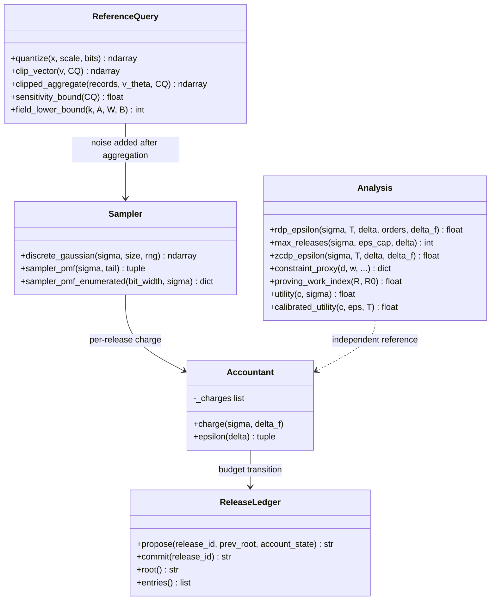

---

## Quick start

```bash
python -m venv .venv && . .venv/bin/activate
pip install -r requirements.txt
pytest -q                          # 15 tests
python -m analysis.figures         # regenerates results/fig3..fig9
```

**Requirements:** Python 3.11+, `numpy`, `scipy`, `matplotlib`, `pytest`. No other runtime
dependencies — the ledger uses stdlib `sqlite3`.

---

## Usage

### Conservative privacy accounting

```python
from dp.accountant import Accountant, rdp_epsilon, max_releases

rdp_epsilon(sigma=4, T=10)          # 4.1063
max_releases(sigma=4, eps_cap=8)    # 33

ac = Accountant(sampler_allowance=0.05)
for _ in range(10):
    ac.charge(sigma=4.0)
lo, hi = ac.epsilon()               # (2.995, 4.156) — enforce with `hi`
```

### Exact discrete Gaussian noise

```python
import numpy as np
from dp.sampler import discrete_gaussian, sampler_pmf

x, p, tail = sampler_pmf(sigma=2.0)      # exact pmf over finite support
print(tail)                              # excluded tail mass ≈ 5e-15
noise = discrete_gaussian(2.0, size=1000, rng=np.random.default_rng(0))
```

### Append-only release ledger

```python
from dp.ledger import ReleaseLedger, GENESIS

lg = ReleaseLedger("ledger.db")
r1 = lg.propose("rel-1", GENESIS, {"eps": 0.5})
lg.commit("rel-1")
lg.root()                                # content hash of last committed state
```

### Quantized aggregate query

```python
import numpy as np
from quant.reference_query import clipped_aggregate, sensitivity_bound, field_lower_bound

records = np.random.default_rng(0).normal(0, 1, size=(256, 16)).astype(np.float32)
v_theta = lambda r: np.round(r * 4).astype(np.int64)
z = clipped_aggregate(records, v_theta, CQ=8.0)
sensitivity_bound(8.0)                   # 16.0
field_lower_bound(k=128, A=127, W=127, B=255)   # 4129534
```

---

## Acceptance numbers

Every value below is asserted in the test suite and reproduces the paper (Sections VII–VIII, Table VI).

| Quantity | Paper | This repo | Equation |
|---|---|---|---|
| RDP→DP ε, σ=4, T=10 | ≈ 4.106 | **4.1063** | Eq. 4 |
| RDP→DP ε, σ=4, T=40 | ≈ 8.838 | **8.8376** | Eq. 4 |
| max releases at ε ≤ 8, σ=4 | 33 | **33** | Eq. 4 |
| constraint total R, d=8 w=128 | 160316 | **160316** | Eq. 12 |
| overhead vs ML-only | ≈ 22.3% | **22.31%** | Eq. 12 |
| proving-work index IP(160316) | ≈ 1.244 | **1.244** | Eq. 13 |
| utility U(c=1, σ=2) | — | **0.7069** | Eq. 14 |

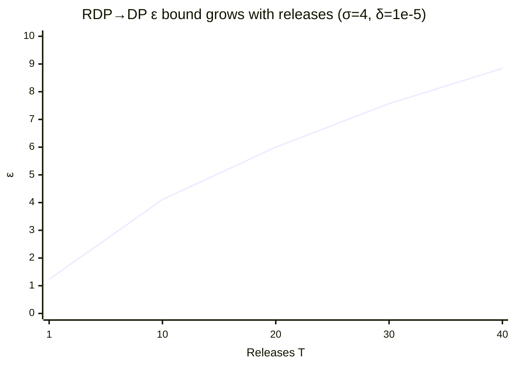

The default constraint decomposition at `d=8, w=128`:

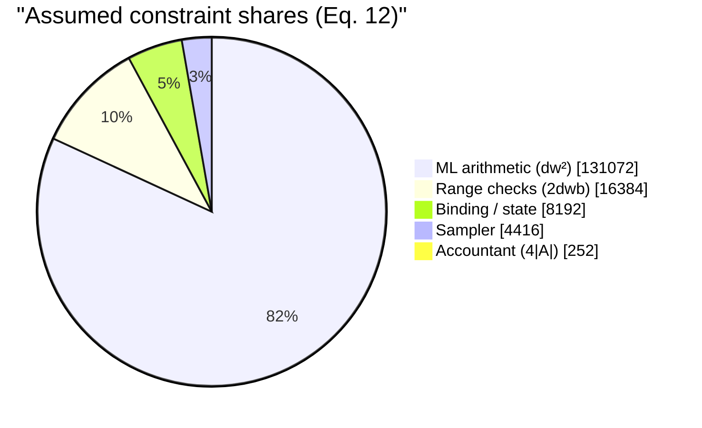

---

## API reference

### `analysis/` — analytical reproduction (Track A)

| Function | Returns | Paper |
|---|---|---|
| `rdp_epsilon(sigma, T, delta=1e-5, orders=2..64, delta_f=1.0)` | ε bound | Eq. 4 |
| `max_releases(sigma, eps_cap, delta=1e-5)` | integer T | Eq. 4 |
| `zcdp_epsilon(sigma, T, delta=1e-5, delta_f=1.0)` | ε via zCDP | Eq. 5 |
| `constraint_proxy(d, w, m=64, b=8, bu=32, sigma=2.0, bind=8192)` | dict of proxies | Eq. 12 |
| `proving_work_index(R, R0=131072)` | dimensionless index | Eq. 13 |
| `utility(c, sigma)` | clipped score | Eq. 14 |
| `calibrated_utility(c, eps, T=1)` | score at calibrated σ | Eq. 4+14 |
| `log_iv_params(s)` / `verification_density(...)` | log-normal params / pdf | Eq. 15 |

### `dp/` — DP core (Track B)

| Symbol | Purpose |
|---|---|
| `sampler_pmf(sigma, tail=1e-12)` | exact implemented pmf + excluded tail mass |
| `discrete_gaussian(sigma, size, rng)` | sampling from that pmf |
| `sampler_pmf_enumerated(bit_width, sigma)` | exhaustive pmf for small bit widths |
| `Accountant` | interval-valued `(tighter, conservative)` ε; enforce with the upper end |
| `ReleaseLedger` | SQLite append-only, single-successor, content-hashed roots |

### `quant/` — quantized reference query (Track C)

| Function | Purpose |
|---|---|
| `quantize(x, scale, bits=8)` | $Q_b(a)=\text{clip}(\text{round}(2^b a))$ |
| `clip_vector(v, CQ)` | radial L2 clipping to the ball |
| `clipped_aggregate(records, v_theta, CQ)` | $g_\theta(D)=\sum_r \mathrm{clip}(v_\theta(r))$ |
| `sensitivity_bound(CQ)` | $2C_Q$ |
| `field_lower_bound(k, A, W, B)` | $2(kAW+B)$ |

---

## Analytical figures

Generated by `python -m analysis.figures`. These are **analytical** panels evaluating the stated
formulas — never labeled accuracy, milliseconds, or proof size (paper Sec. VII-A).

| Figure | Content |
|---|---|
| 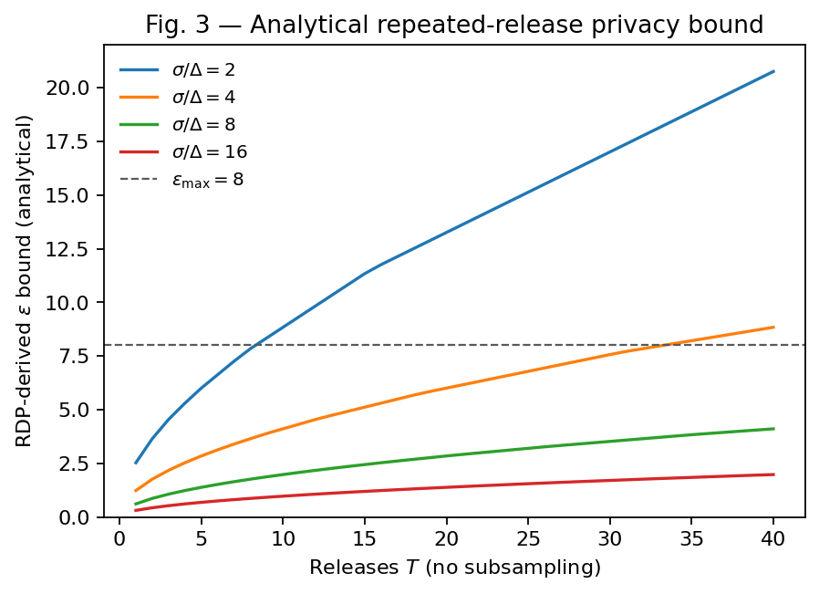 | **Fig. 3** — RDP→DP bound over repeated releases |
| 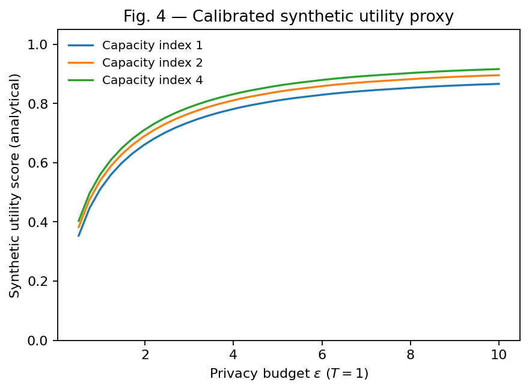 | **Fig. 4** — calibrated synthetic utility |
| 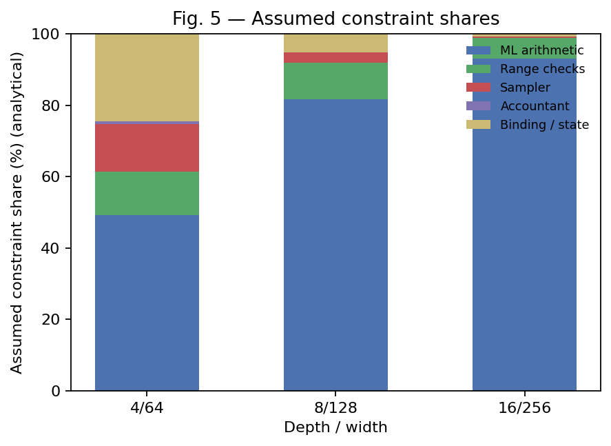 | **Fig. 5** — assumed constraint shares |
| 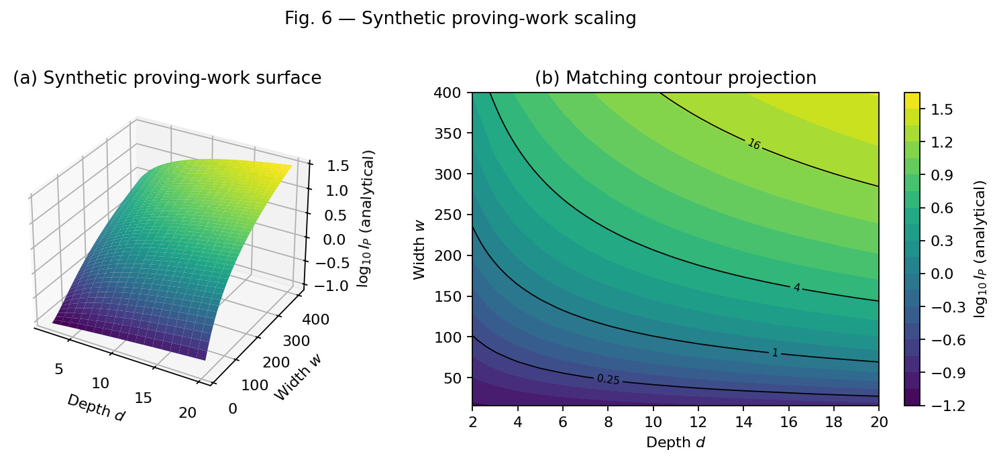 | **Fig. 6** — proving-work surface + contour |
| 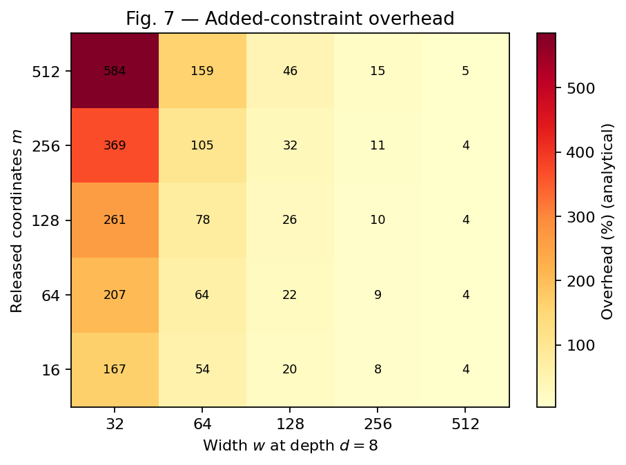 | **Fig. 7** — added-constraint overhead heatmap |
| 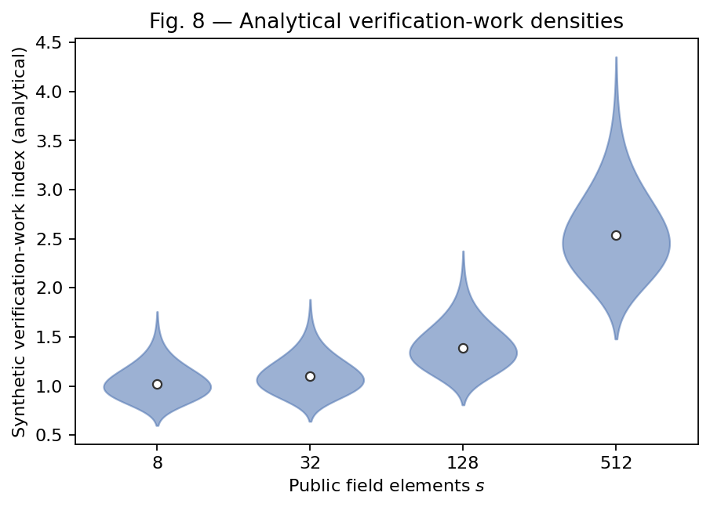 | **Fig. 8** — synthetic verification densities |
| 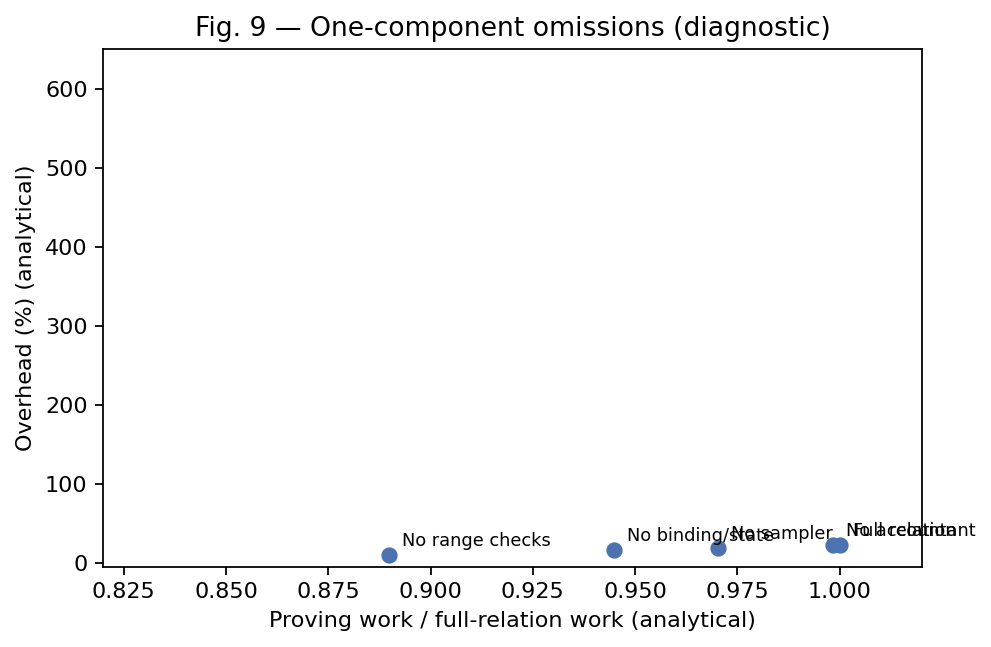 | **Fig. 9** — one-component omission ablation |

---

## Testing

```bash
pytest -q                 # 15 passed
pytest -q -k test_a       # Track A only
pytest -q -k test_b       # Track B only
```

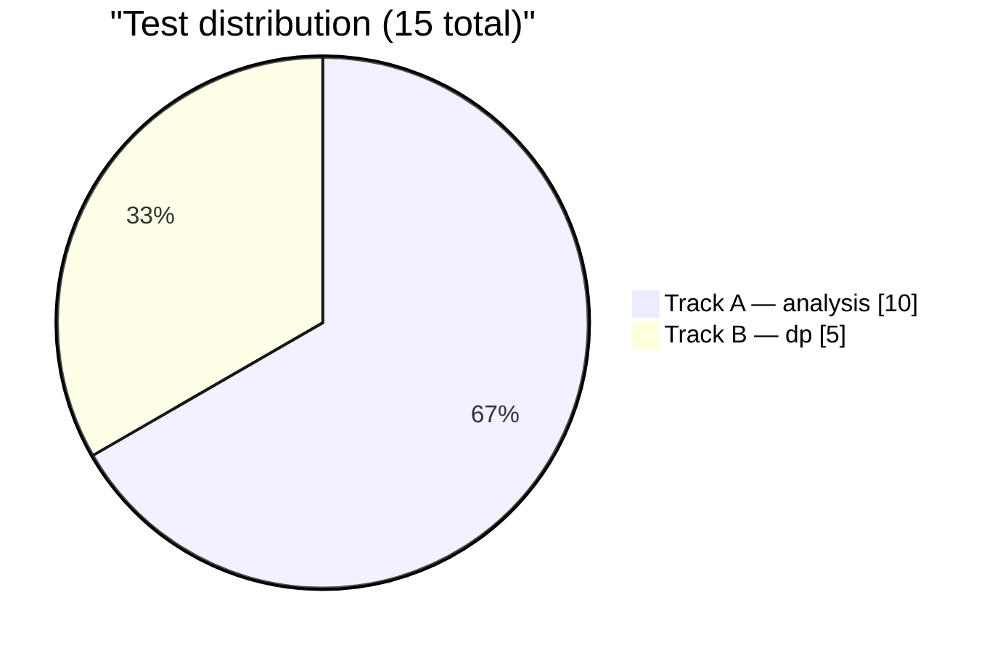

Each non-trivial module also carries a runnable `__main__` self-check:

```bash
python dp/sampler.py          # mean/var/tail-mass assertions
python dp/accountant.py       # paper acceptance numbers
python dp/ledger.py           # single-successor + duplicate-id rejection
python quant/reference_query.py  # sensitivity ≤ 2CQ
```

---

## Roadmap

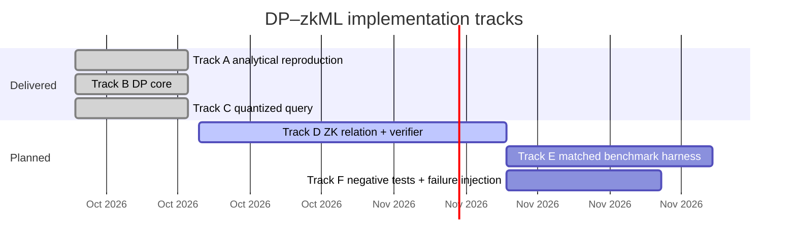

Track D (the headline implementation) is blocked on one decision: **EZKL-first** (fastest working
prove/verify loop) versus a **hand-written circom** relation (full control over the sampler and
accountant constraints).

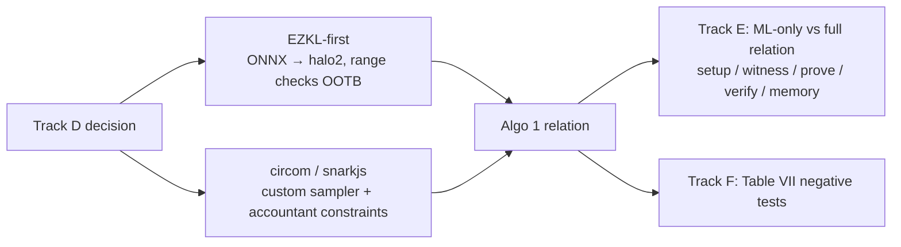

---

## Design rules

1. **Metrics naming.** Synthetic panels are labeled *analytical*. Never *accuracy*, *ms*, or
   *proof size* on a formula-derived ordinate (paper Sec. VII-A).
2. **Conservative accounting.** Enforce budgets with the *upper* end of the interval; never
   understate expenditure. A crash after possible publication keeps its charge.
3. **No free obligations.** Omitting range checks, the sampler, the accountant, or state binding
   does not yield a "cheaper secure variant" — it breaks the guarantee (paper Fig. 9).
4. **Track ownership.** Each track owns its directory; tests are prefixed `test_a_*` / `test_b_*`.

---

## Citation

```bibtex
@misc{mitra_dpzkml,
  title  = {Zero-Knowledge Machine Learning with Differential Privacy:
            A Unified Architecture, Security Analysis, and Deployment Roadmap
            for Trustworthy Cloud AI},
  author = {Mitra, Tanay and Adithyan, K. R. and Mitra, Sagnik and Karthikeyan, P. R.},
  note   = {Vellore Institute of Technology, Chennai, India}
}
```

## License

Provided as-is for research use. See repository owner for terms.
